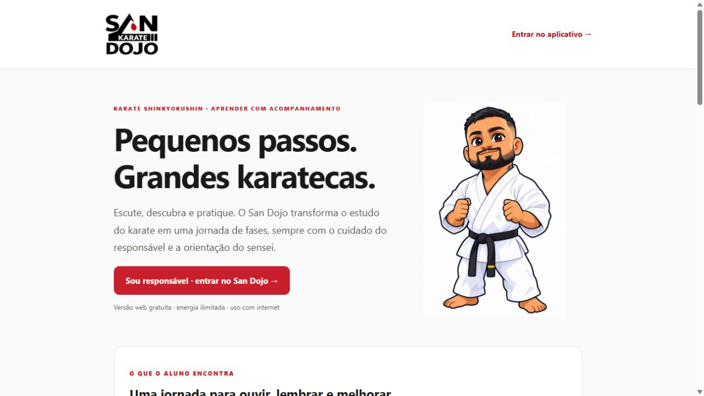

# San Dojo 🥋

Aplicativo web de aprendizagem de **karatê Shinkyokushin**, criado para o San Dojo. Combina atividades curtas, pronúncia japonesa e progressão para incentivar a prática com acompanhamento do sensei.

**[Acessar o aplicativo](https://sandojokarate.netlify.app/)** · **[Guia de aprendizagem](https://sandojokarate.netlify.app/aprender.html)**



## O projeto

O San Dojo aproxima o estudo do karatê da rotina dos alunos: apresenta conceitos em pequenas etapas, oferece retorno nas respostas e registra a constância. A progressão de faixa é ilustrativa, válida apenas dentro do aplicativo. A prática física e a avaliação técnica continuam sob orientação do professor.

## Funcionalidades

- **32 módulos e 102 fases**, com dificuldade progressiva e trilhas de Kihon e Idogeiko para 13 graduações ilustrativas.
- Exercícios de vocabulário, posições, técnicas e princípios do dojo.
- Catálogo de **23 katas** e **32 técnicas de Kihon**, organizado por Te waza, Ashi waza, Shuto waza e Uke waza.
- Áudios de pronúncia japonesa, contagem e sete juramentos em português e japonês.
- XP semanal, requisitos de estudo e confirmação de práticas pelo sensei.
- Sequência diária, calendário de atividades e marcos de constância.
- Login Google via Supabase, progresso por conta e painel administrativo de materiais.
- Controles de responsáveis e separação de permissões entre aluno e administrador.
- Interface responsiva com identidade visual própria e uso pela Tela de Início do iPhone.

Os lembretes Web Push estão implementados e em validação de entrega em aparelhos reais. O acesso Apple e a publicidade estão desativados nesta versão. Os vídeos próprios de demonstração serão adicionados posteriormente.

## Tecnologias e decisões

| Camada | Implementação |
| --- | --- |
| Interface | HTML, CSS e JavaScript, sem framework de interface |
| Áudio | Arquivos MP3 em japonês e Web Audio para retorno de acerto |
| Autenticação e dados | Supabase Auth, PostgreSQL e regras RLS |
| Materiais | Supabase Storage, com gestão restrita ao administrador |
| Lembretes | Service Worker, Web Push, Edge Function e agendamento no servidor |
| Hospedagem | Netlify |
| Verificação | Testes automatizados com `node:test` |

A autorização de materiais e progresso é aplicada no banco, além das verificações da interface. O calendário considera o horário de Brasília. Atividades repetidas no mesmo dia contam uma única vez para a sequência.

## Executar localmente

É necessário Node.js 20 ou posterior. A demonstração não exige dependências adicionais:

```bash
git clone https://github.com/AndreBigD/san-dojo.git
cd san-dojo
npm start
```

Abra **http://localhost:4173**. Sem configuração do Supabase, o aplicativo funciona como demonstração local. Login real, permissões de servidor e notificações exigem um projeto próprio e HTTPS.

```bash
npm test
```

Os testes verificam progressão semanal, bloqueio e liberação de fases, requisitos de prática, referências de áudio e contagem de dias.

## Organização

```text
dist/                Interface, conteúdo e arquivos estáticos
dist/assets/         Identidade visual e áudios
backend/             Estrutura SQL, permissões e serviço de notificações
docs/                Configuração e imagem do projeto
licenses/            Licenças de dependências distribuídas
test-*.cjs           Testes de domínio
```

Veja [como configurar um ambiente próprio](docs/CONFIGURACAO.md). A publicação no Netlify utiliza a pasta `dist`.

## Autoria e desenvolvimento

Projeto idealizado e conduzido por **André — San Dojo**, com desenvolvimento iterativo apoiado por ferramentas de IA. O conteúdo pedagógico é revisado pelo responsável do dojo.

Este repositório apresenta o projeto e seu código para portfólio. Não inclui contas, dados de alunos, senhas ou chaves privadas. A marca, as imagens e o conteúdo do San Dojo não recebem uma licença de reutilização por esta publicação. As licenças de terceiros estão em `licenses/`.
